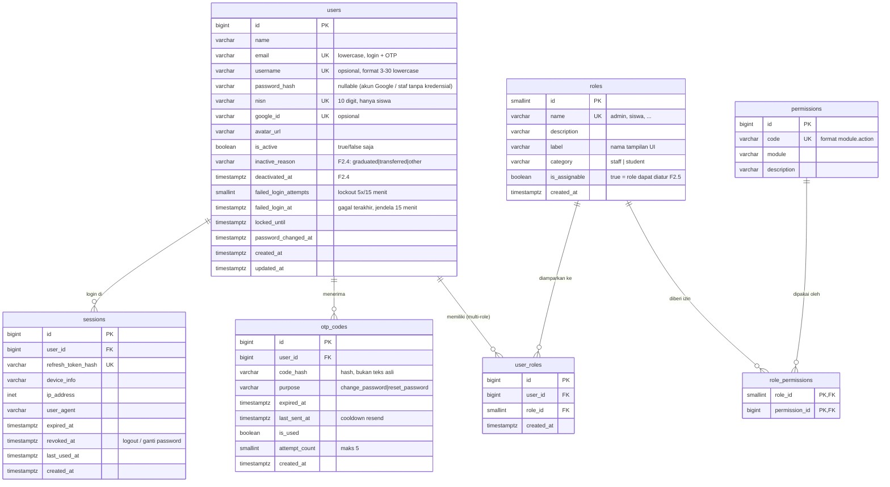

# Desain Database — E-Absensi

**Scope dokumen ini:** Epic 1 — *Authentication & Account Management* + Epic 2 — *User & Role Management* (detail, siap implementasi) + peta arsitektural seluruh sistem.

Cara menjalankan skema, konvensi migrasi, dan backup/restore ada di [README.md](./README.md).

| Item | Nilai |
|---|---|
| DBMS | PostgreSQL (diuji pada PostgreSQL 18.6 / Windows) |
| File DDL | [`001_epic1_auth.sql`](./sql/001_epic1_auth.sql) (skema Epic 1) · [`002_access_and_encoding.sql`](./sql/002_access_and_encoding.sql) (akses team + encoding) · [`003_add_failed_login_at.sql`](./sql/003_add_failed_login_at.sql) (jendela lockout 15 menit) · [`004_epic2_user_role_management.sql`](./sql/004_epic2_user_role_management.sql) (Epic 2: status nonaktif, metadata role, RBAC) |
| Sumber requirement | `PRD Utama.docx` (revisi 3) + `PRD EPIC 1.docx` (v2.1) + `PRD EPIC 2.docx` (v1.0) |
| Tabel | `roles`, `users`, `user_roles`, `otp_codes`, `sessions` (Epic 1) · `permissions`, `role_permissions` (Epic 2) |

## 1. ERD



## 2. Ringkasan per tabel

### `roles` — 7 role (seed) + metadata Epic 2
Referensi tetap. Diisi otomatis saat import: `admin`, `waka_kurikulum`, `waka_kesiswaan`, `guru_mapel`, `wali_kelas`, `siswa_inti`, `siswa`.

`wali_kelas` dan `siswa_inti` adalah **role tambahan** pada akun Guru/Siswa (bukan akun terpisah) — didukung oleh relasi many-to-many `user_roles`.

Metadata Epic 2 (`004`): `label` (nama tampilan UI), `category` (`staff`/`student` — dasar validasi kombinasi role), `is_assignable` (`true` untuk `admin`, `waka_kurikulum`, `waka_kesiswaan`, `guru_mapel`; `false` = role terkunci yang tidak boleh disentuh Admin lewat F2.5).

### `users` — satu baris = satu akun login
- `email` wajib, unik **case-insensitive** (index `lower(email)`), disimpan lowercase oleh trigger.
- `password_hash` nullable untuk akun Google-only; format hash dicek minimal diawali `$`. CHECK Epic 1 yang mewajibkan "password atau Google" **dihapus di `004`** — F2.2 membuat akun staf tanpa kredensial; login pertama lewat link/Google/Reset Password.
- `nisn` nullable + unik, format 10 digit — hanya untuk akun siswa.
- Kolom lockout (3): `failed_login_attempts` (counter), `failed_login_at` (waktu kegagalan terakhir — dasar jendela 15 menit), `locked_until` (hasil kunci). Counter direset bila jeda sejak `failed_login_at` melebihi 15 menit, sehingga "5 gagal dalam 15 menit -> kunci 15 menit" sesuai PRD Bagian 3.B; kegagalan yang tersebar berhari-hari tidak ikut mengakumulasi. `NULL` pada `failed_login_at` = belum pernah gagal atau baru direset.
- `is_active` boolean — **hanya 2 status akun** (tidak ada pending/locked permanen, PRD Bagian 3.A).
- Kolom status nonaktif (Epic 2 F2.4): `inactive_reason` (`graduated` lulus / `transferred` pindah / `other` lainnya) + `deactivated_at`. `CHECK ck_users_inactive_state` menegakkan konsistensi dua arah: aktif = keduanya `NULL`; nonaktif = keduanya terisi.
- `username` berformat `^[a-z0-9._]{3,30}$` (`ck_users_username_format`, PRD Epic 2 Bagian 7.C).
- Tidak ada kolom `deleted_at` — penonaktifan = `is_active = false` (+ alasan & waktu).
- Index `ix_users_name` untuk pencarian daftar akun (F2.1). Pencarian `contains` (`%q%`) tidak memakai index btree; bila terbukti lambat, solusinya migrasi terpisah dengan `pg_trgm` (GIN) — tidak dicampur di `004` agar dump tidak bergantung pada extension.

### `user_roles` — kunci fitur F1.8 (union)
`UNIQUE(user_id, role_id)` mencegah role ganda; `FK role_id ON DELETE RESTRICT` (role master tak boleh terhapus selama dipakai); `FK user_id ON DELETE CASCADE`.

**Tidak ada kolom "role aktif"** — baik di `user_roles` maupun `sessions`. Otorisasi Backend selalu mengambil seluruh set role dari tabel ini (union), sesuai PRD utama KS-32.

### `otp_codes` — dipakai F1.4 (ganti) & F1.5 (reset)
- `purpose` di-`CHECK` hanya `change_password` / `reset_password` → isolasi purpose tereksekusi di level DB.
- `code_hash` — OTP tidak pernah disimpan plaintext.
- `last_sent_at` — dasar cooldown resend (60 detik) & batas 5 resend/jam.
- `attempt_count` — maksimal 5 percobaan salah per kode; melebihi batas itu kode dianggap tidak valid.
- `is_used` — sekali pakai; resend baru = tandai baris lama `is_used = true` (hanya 1 OTP aktif per user per purpose).
- Partial index `WHERE is_used = false` mempercepat "ambil OTP aktif terbaru".

### `sessions` — 1 baris = 1 device
- `refresh_token_hash` unik (access token 15 menit tidak disimpan di DB).
- `revoked_at` — **soft revoke**: logout mengisi kolom ini hanya untuk baris tersebut; ganti/reset password mengisi untuk **seluruh** baris milik user (`UPDATE sessions SET revoked_at = now() WHERE user_id = ? AND revoked_at IS NULL`, didukung partial index `ix_sessions_user_live`).
- Multi-device tanpa batas jumlah sesi (PRD F1.7).
- Kolom `ip_address`, `user_agent`, `last_used_at` = tambahan untuk audit/keamanan.
- Penonaktifan akun (F2.4) juga mencabut seluruh sesi aktif — Backend memakai mekanisme revoke yang sama, ditambah pengecekan `is_active` pada setiap request.

### `permissions` — kamus izin (Epic 2 F2.7)
`code` unik berformat `module.action` (huruf kecil, titik) — dipakai Backend pada middleware `requirePermission`. `module` = pengelompokan Matriks Hak Akses; `description` = teks human-readable untuk UI Admin. Diisi oleh seeder/migrasi epic masing-masing — `004` menanam 7 permission Epic 2 (`account.*`, `role.assign`, `permission.view`).

### `role_permissions` — pemberian izin per role (Epic 2 F2.7)
PK gabungan `(role_id, permission_id)`; `role_id` FK **ON DELETE RESTRICT** (role master tidak boleh terhapus selama izin terpasang); `permission_id` FK **ON DELETE CASCADE** (permission dicabut = pemberiannya ikut hilang); index `ix_role_permissions_permission` untuk pertanyaan "role mana saja yang punya izin ini".

Matriks bersifat **baku** (PRD Bagian 11): pemberian izin diubah lewat migrasi/seeder, **tidak** lewat UI. Seluruh 7 permission Epic 2 diberikan ke `admin` saja. Epic berikutnya menambahkan permission modulnya sendiri ke kedua tabel ini.

### Trigger
| Trigger | Fungsi |
|---|---|
| `trg_users_normalize` (BEFORE INSERT/UPDATE) | `lower(btrim(email))`, trim `username`/`nisn` — menjamin kepatuhan `CHECK email = lower(email)` |
| `trg_users_updated_at` (BEFORE UPDATE) | auto-set `updated_at` — juga dasar optimistic locking F2.3 |

---

## 3. Deviasi / penambahan dari PRD

Baseline = tabel Bagian 8 PRD Epic 1 + Bagian 8 PRD Epic 2. Semua kolom PRD dipertahankan; berikut **tambahan & perubahan**:

| # | Tabel | Tambahan / Perubahan | Alasan |
|---|---|---|---|
| 1 | `users` | `password_changed_at` | Audit + jejak "kapan password terakhir berubah" |
| 2 | `users` | index `lower(email)` + trigger normalisasi | PRD mewajibkan email case-insensitive; UNIQUE biasa tidak cukup |
| 3 | `otp_codes` | `last_sent_at` | Cooldown resend 60 dtk & batas 5 resend/jam (F1.6) butuh waktu kirim terakhir |
| 4 | `sessions` | `revoked_at` | "Invalidate semua sesi" (F1.4/F1.5) butuh penanda revoke tanpa menghapus baris (audit tetap ada) |
| 5 | `sessions` | `ip_address`, `user_agent`, `last_used_at` | Pelengkap `device_info`, berguna untuk debugging & keamanan |
| 6 | semua | `COMMENT ON ...` | Dokumentasi schema bawaan PostgreSQL |
| 7 | `users` | CHECK `ck_users_password_or_google` **dihapus di `004`** | Epic 1 mewajibkan minimal password ATAU Google; F2.2 membuat akun staf tanpa kredensial — dua aturan tidak bisa hidup berdampingan |
| 8 | `users` | `failed_login_at` (lewat `003_add_failed_login_at.sql`) | PRD 3.B menuntut 5 gagal **dalam 15 menit**; counter tanpa penanda waktu tidak bisa mengukur jendela |
| 9 | `users` | `inactive_reason`, `deactivated_at` + `CHECK ck_users_inactive_state` (lewat `004`) | F2.4 menuntut alasan & waktu penonaktifan tersimpan; CHECK menjaga konsistensi dua arah |
| 10 | `roles` | `label`, `category`, `is_assignable` | F2.5: role assignable vs terkunci & validasi kombinasi (staff/student) dihitung dari DB |
| 11 | `users` | `CHECK ck_users_username_format` | PRD 7.C: username 3-30 karakter huruf kecil/angka/titik/underscore |
| 12 | `permissions`, `role_permissions` | 2 tabel baru | F2.7: Matriks Hak Akses baku + otorisasi permission-based |
| 13 | `users` | index `ix_users_name` | Rekomendasi Bagian 8 untuk pencarian daftar akun (F2.1) |

Tidak ada kolom PRD yang **dihapus**. Kolom `active_role_id` tidak dipasang karena sudah dihapus dari PRD v2.1.

Catatan lintas tim akibat #7 dan #11: Backend **tidak boleh lagi** mengandalkan `ck_users_password_or_google` (boleh membuat akun tanpa kredensial) dan **wajib** lowercase + validasi format username sebelum INSERT/UPDATE.

## 4. Keputusan teknis

| Topik | Keputusan | Alternatif |
|---|---|---|
| Tipe ID | `bigint GENERATED ALWAYS AS IDENTITY` | UUIDv7 bila butuh ID tak tertebak lintas sistem |
| Enum (`purpose`, `inactive_reason`, `category`, `roles.name`) | `VARCHAR + CHECK/UNIQUE` (bukan `CREATE TYPE`) | `CREATE TYPE` — lebih ketat, tapi tiap perubahan = migration ekstra |
| Kredensial awal akun staf (F2.2) | Tanpa password & tanpa Google (`NULL`/`NULL`); login pertama lewat link akun, Google, atau Reset Password | CHECK "minimal satu kredensial" (Epic 1) — tidak kompatibel dengan F2.2, sudah dihapus |
| Case username | Penyimpanan case-**sensitive**, tapi format dicegah berkapital lewat CHECK Epic 2 (`^[a-z0-9._]{3,30}$`) | Case-insensitive unik (menolak `Budi` dan `budi` sekaligus) |
| Format NISN | 10 digit angka (`^[0-9]{10}$`) | Rentang lebih longgar (`6–20` digit) |
| Otorisasi | **RBAC berbasis permission (Epic 2)**: tabel `permissions` + `role_permissions`, akses = union seluruh role akun, **default deny** di Backend; matriks baku disiapkan seeder | Tanpa tabel permission — pemetaan endpoint→role di kode BE (keputusan Epic 1, digantikan oleh PRD Epic 2) |
| Audit login gagal | Hanya state terkini di `users`: counter + `failed_login_at` + `locked_until` (sesuai PRD) | Tabel `login_attempts` berisi tiap percobaan untuk riwayat login penuh |
| `deleted_at` | Tidak dipakai — nonaktif = `is_active = false` (+ `inactive_reason`, `deactivated_at`) | Soft delete untuk arsip baris |
| Aturan kombinasi role & "minimal 1 Admin aktif" | Level aplikasi (transaksi + row lock) — kolom `category`/`is_assignable` menyediakan dasar data, tanpa trigger DB | Constraint trigger DB — kompleks, sulit diuji |
| Pencarian daftar akun (F2.1) | Btree `users(name)` dulu (rekomendasi PRD) | `pg_trgm` GIN untuk `contains` — dipertimbangkan sebagai migrasi `005` bila terbukti lambat |

**Status akun:** `active` / `inactive`, dengan alasan & waktu penonaktifan (Epic 2 F2.4). Tidak ada status lain.

---

## 5. Peta arsitektural seluruh sistem

> Ringkasan tingkat tinggi seluruh tabel E-Absensi — acuan agar desain Epic 1 & 2 konsisten dengan arsitektur keseluruhan.

```mermaid
erDiagram
    users ||--o| students           : "profil siswa"
    users ||--o| teachers           : "profil guru"
    academic_years ||--o{ classes   : "memiliki"
    subjects ||--o{ schedules       : "diamparkan"
    classes ||--o{ class_memberships : "berisi siswa"
    students ||--o{ class_memberships : "anggota"
    classes ||--o{ class_officers   : "siswa inti"
    schedules ||--o{ attendance_sessions : "per tanggal"
    attendance_sessions ||--o{ student_attendance : "per siswa"
    attendance_sessions ||--o{ teacher_attendance : "scan QR"
    attendance_sessions ||--o{ teaching_journals   : "isian guru"
    qr_sessions ||--o| attendance_sessions : "konfirmasi 30 detik"
    students ||--o{ permission_forms : "izin/sakit (maks 09.00)"
    students ||--o{ letter_uploads   : "surat tatib/dispensasi"
    roles ||--o{ role_permissions : "diberi izin (Epic 2)"
    permissions ||--o{ role_permissions : "kamus izin (Epic 2)"

    academic_years { int id PK "tahun ajaran + semester" }
    subjects        { int id PK "mata pelajaran" }
    classes         { int id PK "kelas + wali kelas" }
    students        { bigint id PK, bigint user_id FK, varchar nisn UK, int class_id FK }
    teachers        { bigint id PK, bigint user_id FK }
    class_memberships { bigint id PK, int class_id FK, bigint student_id FK }
    class_officers  { bigint id PK, int class_id FK, bigint student_id FK, varchar position }
    schedules       { bigint id PK, date schedule_date, int period, int class_id, int subject_id, int teacher_id }
    school_activities { bigint id PK, date activity_date, varchar name }
    attendance_sessions { bigint id PK, bigint schedule_id FK, date session_date, varchar status }
    qr_sessions     { bigint id PK, bigint session_id FK, varchar code, timestamptz expires_at, boolean is_used }
    teacher_attendance { bigint id PK, bigint session_id FK, int teacher_id, varchar status, int substitute_of }
    student_attendance { bigint id PK, bigint session_id FK, bigint student_id FK, varchar status, bigint edited_by }
    permission_forms { bigint id PK, bigint student_id FK, date form_date, varchar type, varchar status }
    letter_uploads  { bigint id PK, bigint student_id FK, varchar letter_type, varchar file_url }
    teaching_journals { bigint id PK, bigint session_id FK, text materi, text description, boolean submitted }
    notifications   { bigint id PK, bigint user_id FK, text payload, boolean is_read }
    activity_logs   { bigint id PK, bigint user_id FK, varchar action, timestamptz created_at }
    roles           { smallint id PK, varchar name UK, varchar label, varchar category, boolean is_assignable }
    permissions     { bigint id PK, varchar code UK, varchar module }
    role_permissions { smallint role_id PK,FK, bigint permission_id PK,FK }
```

### Catatan arsitektural

1. **`users` vs `students`/`teachers`** — `nisn` ditampung di `users` karena registrasi siswa (F1.1) menuntut NISN sejak akun dibuat; profil siswa/guru berupa tabel sendiri yang terhubung lewat `user_id` FK → `users`.
2. **Absensi per jam pelajaran** — inti sistem adalah `attendance_sessions` (1 baris = jadwal × tanggal × kelas), sehingga absensi benar-benar *per mata pelajaran per pertemuan*, bukan sekali di awal hari. QR 30 detik (`qr_sessions`) membuka form ceklis → `student_attendance`.
3. **Guru pengganti** — `teacher_attendance.status` ∈ `Hadir | Guru Pengganti | Tidak Hadir`, dengan `substitute_of` menunjuk guru pada jadwal; deteksi otomatis dari pembandingan scanner vs jadwal.
4. **Jadwal berbasis tanggal** — `schedules.schedule_date` (bukan hari-in-a-week); kegiatan sekolah = `school_activities` + `schedule_overrides` yang mengubah jadwal tanggal tertentu.
5. **Jurnal terpisah dari absensi** — `teaching_journals` tetap ada meski `teacher_attendance.status = Tidak Hadir` (PRD KS-18), dengan flag `submitted` untuk menandai "Guru Mapel tidak mengisi jurnal".
6. **Multi-role** — otorisasi seluruh modul dihitung dari union `user_roles`; tidak ada kolom "role aktif" di tabel mana pun.
7. **FK ke `users.id` wajib `ON DELETE RESTRICT`** pada seluruh tabel epic berikutnya — F2.6 hanya mengizinkan penghapusan akun staf yang tidak punya riwayat; cascade hanya berlaku untuk tabel Epic 1 (`user_roles`, `sessions`, `otp_codes`).
8. **`activity_logs`** dikerjakan di Epic 13 — Epic 2 baru menghasilkan event (ACCOUNT_CREATED, ROLE_ASSIGNED, dst.), sementara Backend menampungnya lewat abstraksi logger.
