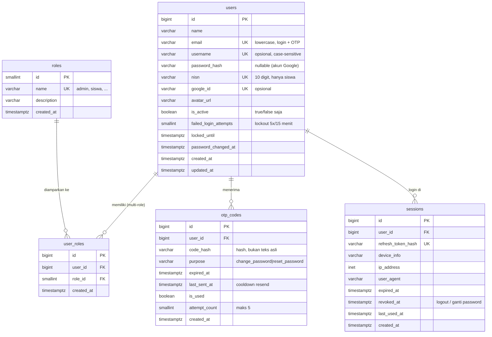

# Desain Database — E-Absensi

**Scope dokumen ini:** Epic 1 — *Authentication & Account Management* (detail, siap implementasi) + peta arsitektural seluruh sistem.

| Item | Nilai |
|---|---|
| DBMS | PostgreSQL (diuji pada PostgreSQL 18.6 / Windows) |
| File DDL | [`001_epic1_auth.sql`](./001_epic1_auth.sql) (skema Epic 1) · [`002_access_and_encoding.sql`](./002_access_and_encoding.sql) (akses team + encoding) |
| Sumber requirement | `PRD Utama.docx` (revisi 3) + `PRD EPIC 1.docx` (v2.1) |
| Tabel Epic 1 | `roles`, `users`, `user_roles`, `otp_codes`, `sessions` |

## Cara menjalankan

```powershell
psql -U akyrr -d absensi -v ON_ERROR_STOP=1 -f database\001_epic1_auth.sql
psql -U akyrr -d absensi -v ON_ERROR_STOP=1 -f database\002_access_and_encoding.sql
```

**Idempotensi:** kedua file **idempotent — aman dijalankan berulang** (`CREATE ... IF NOT EXISTS`, seed `ON CONFLICT DO NOTHING`, `GRANT`/`ALTER` tidak error bila sudah terpenuhi). Perubahan struktur dikerjakan lewat file migration terpisah. Reset lingkungan dev: `DROP TABLE sessions, otp_codes, user_roles, users, roles CASCADE;` lalu jalankan ulang.

---

## 1. ERD Epic 1



## 2. Ringkasan per tabel

### `roles` — 7 role (seed)
Referensi tetap. Diisi otomatis saat import: `admin`, `waka_kurikulum`, `waka_kesiswaan`, `guru_mapel`, `wali_kelas`, `siswa_inti`, `siswa`.

`wali_kelas` dan `siswa_inti` adalah **role tambahan** pada akun Guru/Siswa (bukan akun terpisah) — didukung oleh relasi many-to-many `user_roles`.

### `users` — satu baris = satu akun login
- `email` wajib, unik **case-insensitive** (index `lower(email)`), disimpan lowercase oleh trigger.
- `password_hash` nullable untuk akun Google-only; `CHECK` memastikan minimal diawali `$` (format bcrypt/argon2).
- `nisn` nullable + unik, format 10 digit — hanya untuk akun siswa.
- Kolom lockout: `failed_login_attempts` + `locked_until` (5 gagal/15 menit → kunci 15 menit, PRD Bagian 3.B).
- `is_active` boolean — **hanya 2 status akun** (tidak ada pending/locked permanen, PRD Bagian 3.A).
- Tidak ada kolom `deleted_at` — penonaktifan = `is_active = false`.

### `user_roles` — kunci fitur F1.8 (union)
`UNIQUE(user_id, role_id)` mencegah role ganda; `FK role_id ON DELETE RESTRICT` (role master tak boleh terhapus selama dipakai); `FK user_id ON DELETE CASCADE`.

**Tidak ada kolom "role aktif"** — baik di `user_roles` maupun `sessions`. Otorisasi Backend selalu mengambil seluruh set role dari tabel ini (union), sesuai PRD utama KS-32.

### `otp_codes` — dipakai F1.4 (ganti) & F1.5 (reset)
- `purpose` di-`CHECK` hanya `change_password` / `reset_password` → isolasi purpose tereksekusi di level DB.
- `code_hash` — OTP tidak pernah disimpan plaintext.
- `last_sent_at` — dasar cooldown resend (60 detik) & batas 5 resend/jam.
- `attempt_count` — maksimal 5 percobaan salah per kode; melebihi batas itu kode dianggap tidak valid.
- `is_used` — sekali pakai; resend baru = tandai baris lama `is_used = true` (hanya 1 OTP aktif per user per purpose).
- Partial index `WHERE is_used = false` mempercepat "ambil OTP aktif terbaru".

### `sessions` — 1 baris = 1 device
- `refresh_token_hash` unik (access token 15 menit tidak disimpan di DB).
- `revoked_at` — **soft revoke**: logout mengisi kolom ini hanya untuk baris tersebut; ganti/reset password mengisi untuk **seluruh** baris milik user (`UPDATE sessions SET revoked_at = now() WHERE user_id = ? AND revoked_at IS NULL`, didukung partial index `ix_sessions_user_live`).
- Multi-device tanpa batas jumlah sesi (PRD F1.7).
- Kolom `ip_address`, `user_agent`, `last_used_at` = tambahan untuk audit/keamanan.

### Trigger
| Trigger | Fungsi |
|---|---|
| `trg_users_normalize` (BEFORE INSERT/UPDATE) | `lower(btrim(email))`, trim `username`/`nisn` — menjamin kepatuhan `CHECK email = lower(email)` |
| `trg_users_updated_at` (BEFORE UPDATE) | auto-set `updated_at` |

---

## 3. Deviasi / penambahan dari Bagian 8 PRD Epic 1

Baseline = tabel di Bagian 8. Semua kolom PRD dipertahankan; berikut **tambahan** (PRD tidak melarang, dibutuhkan oleh business rule-nya sendiri):

| # | Tabel | Tambahan | Alasan |
|---|---|---|---|
| 1 | `users` | `password_changed_at` | Audit + jejak "kapan password terakhir berubah" |
| 2 | `users` | index `lower(email)` + trigger normalisasi | PRD mewajibkan email case-insensitive; UNIQUE biasa tidak cukup |
| 3 | `otp_codes` | `last_sent_at` | Cooldown resend 60 dtk & batas 5 resend/jam (F1.6) butuh waktu kirim terakhir |
| 4 | `sessions` | `revoked_at` | "Invalidate semua sesi" (F1.4/F1.5) butuh penanda revoke tanpa menghapus baris (audit tetap ada) |
| 5 | `sessions` | `ip_address`, `user_agent`, `last_used_at` | Pelengkap `device_info`, berguna untuk debugging & keamanan |
| 6 | semua | `COMMENT ON ...` | Dokumentasi schema bawaan PostgreSQL |
| 7 | `users` | `CHECK ck_users_password_or_google` | Mencegah akun tanpa password **dan** tanpa Google (mustahil login) |

Tidak ada kolom PRD yang **dihapus**. Kolom `active_role_id` tidak dipasang karena sudah dihapus dari PRD v2.1.

## 4. Keputusan teknis

| Topik | Keputusan | Alternatif |
|---|---|---|
| Tipe ID | `bigint GENERATED ALWAYS AS IDENTITY` | UUIDv7 bila butuh ID tak tertebak lintas sistem |
| Enum (`purpose`, `roles.name`) | `TEXT/VARCHAR + CHECK/UNIQUE` (bukan `CREATE TYPE`) | `CREATE TYPE` — lebih ketat, tapi tiap perubahan = migration ekstra |
| Case username | **Case-sensitive** | Case-insensitive agar pengetikan username bebas kapitalisasi |
| Format NISN | 10 digit angka (`^[0-9]{10}$`) | Rentang lebih longgar (`6–20` digit) |
| Mapping role → fitur | **Tidak ada tabel `role_permissions`** — set role dibaca dari `user_roles`, pemetaan endpoint→role di kode BE | Tabel `role_permissions` untuk granularitas per izin |
| Audit login gagal | Hanya counter di `users` (sesuai PRD) | Tabel `login_attempts` terpisah untuk riwayat percobaan login |
| `deleted_at` | Tidak dipakai — nonaktif = `is_active = false` | Soft delete untuk arsip baris |

**Status akun (PRD Bagian 3.A):** hanya `active` / `inactive` — tidak ada status lain pada skema ini.

---

## 5. Peta arsitektural seluruh sistem

> Ringkasan tingkat tinggi seluruh tabel E-Absensi — acuan agar desain Epic 1 konsisten dengan arsitektur keseluruhan.

```mermaid
erDiagram
    users ||--o| students           : "profil siswa"
    users ||--o| teachers           : "profil guru"
    academic_years ||--o{ classes   : "memiliki"
    subjects ||--o{ schedules       : "diamparkan"
    classes ||--o{ class_memberships : "berisi siswa"
    students ||--o{ class_memberships : "anggota"
    classes ||--o{ class_officers   : "siswa inti"
    schedules ||--o{ attendance_sessions : "per tanggal"
    attendance_sessions ||--o{ student_attendance : "per siswa"
    attendance_sessions ||--o{ teacher_attendance : "scan QR"
    attendance_sessions ||--o{ teaching_journals   : "isian guru"
    qr_sessions ||--o| attendance_sessions : "konfirmasi 30 detik"
    students ||--o{ permission_forms : "izin/sakit (maks 09.00)"
    students ||--o{ letter_uploads   : "surat tatib/dispensasi"

    academic_years { int id PK "tahun ajaran + semester" }
    subjects        { int id PK "mata pelajaran" }
    classes         { int id PK "kelas + wali kelas" }
    students        { bigint id PK, bigint user_id FK, varchar nisn UK, int class_id FK }
    teachers        { bigint id PK, bigint user_id FK }
    class_memberships { bigint id PK, int class_id FK, bigint student_id FK }
    class_officers  { bigint id PK, int class_id FK, bigint student_id FK, varchar position }
    schedules       { bigint id PK, date schedule_date, int period, int class_id, int subject_id, int teacher_id }
    school_activities { bigint id PK, date activity_date, varchar name }
    attendance_sessions { bigint id PK, bigint schedule_id FK, date session_date, varchar status }
    qr_sessions     { bigint id PK, bigint session_id FK, varchar code, timestamptz expires_at, boolean is_used }
    teacher_attendance { bigint id PK, bigint session_id FK, int teacher_id, varchar status, int substitute_of }
    student_attendance { bigint id PK, bigint session_id FK, bigint student_id FK, varchar status, bigint edited_by }
    permission_forms { bigint id PK, bigint student_id FK, date form_date, varchar type, varchar status }
    letter_uploads  { bigint id PK, bigint student_id FK, varchar letter_type, varchar file_url }
    teaching_journals { bigint id PK, bigint session_id FK, text materi, text description, boolean submitted }
    notifications   { bigint id PK, bigint user_id FK, text payload, boolean is_read }
    activity_logs   { bigint id PK, bigint user_id FK, varchar action, timestamptz created_at }
```

### Catatan arsitektural

1. **`users` vs `students`/`teachers`** — `nisn` ditampung di `users` karena registrasi siswa (F1.1) menuntut NISN sejak akun dibuat; profil siswa/guru berupa tabel sendiri yang terhubung lewat `user_id` FK → `users`.
2. **Absensi per jam pelajaran** — inti sistem adalah `attendance_sessions` (1 baris = jadwal × tanggal × kelas), sehingga absensi benar-benar *per mata pelajaran per pertemuan*, bukan sekali di awal hari. QR 30 detik (`qr_sessions`) membuka form ceklis → `student_attendance`.
3. **Guru pengganti** — `teacher_attendance.status` ∈ `Hadir | Guru Pengganti | Tidak Hadir`, dengan `substitute_of` menunjuk guru pada jadwal; deteksi otomatis dari pembandingan scanner vs jadwal.
4. **Jadwal berbasis tanggal** — `schedules.schedule_date` (bukan hari-in-a-week); kegiatan sekolah = `school_activities` + `schedule_overrides` yang mengubah jadwal tanggal tertentu.
5. **Jurnal terpisah dari absensi** — `teaching_journals` tetap ada meski `teacher_attendance.status = Tidak Hadir` (PRD KS-18), dengan flag `submitted` untuk menandai "Guru Mapel tidak mengisi jurnal".
6. **Multi-role** — otorisasi seluruh modul dihitung dari union `user_roles`; tidak ada kolom "role aktif" di tabel mana pun.

---

## 6. Encoding & akses database untuk team

### 6.1 Encoding & troubleshooting `WIN1252`

Pesan `character with byte sequence 0xe2 0x86 0x92 in encoding "UTF8" has no equivalent in encoding "WIN1252"` artinya **koneksi client berjalan sebagai `client_encoding=WIN1252`** — bukan masalah database (database `absensi` = UTF8). Pemicu paling umum: env `PGCLIENTENCODING` di sesi tersebut (error ini muncul saat `\d+` menampilkan komentar kolom yang berisi `→`).

Pencegahan yang sudah dipasang:

1. **Seluruh file `.sql` wajib murni ASCII** — `→` → `->`, `—` → `-`, emoji tidak dipakai. Karena itu file SQL aman dijalankan/dilihat di koneksi encoding apa pun.
2. **Default koneksi di-set ke UTF8** di `002` (`ALTER DATABASE <nama-db> SET client_encoding TO 'UTF8'`, dieksekusi via `current_database()` sehingga berlaku pada nama database apa pun) — untuk koneksi baru yang tidak menentukan encoding sendiri.
3. Komentar kolom/tabel di database & seed `roles` sudah di-ASCII-kan.

Untuk team:

| Situasi | Tindakan |
|---|---|
| Cek koneksi | `SHOW client_encoding;` → harus `UTF8`. Kalau `source = database`, berarti default server aktif |
| Masih keluar WIN1252 | Ada `PGCLIENTENCODING` di sesi itu — **cmd**: `set PGCLIENTENCODING=` · **PowerShell**: `$env:PGCLIENTENCODING=$null` → buka psql baru |
| Fix sesi tanpa reconnect | `SET client_encoding TO 'UTF8';` |
| Copy-paste | **Jangan** copy isi README (markdown memakai `→`/emoji) ke psql — salin dari file `.sql` saja |

### 6.2 Akses isi database untuk semua role (`PUBLIC`)

`002` membuka akses isi database ke **semua role** lewat grant ke `PUBLIC` (pseudo-role yang mencakup semua role, termasuk role yang dibuat kemudian):

| Level | Yang di-grant |
|---|---|
| Database yang sedang dibuka | `CONNECT` |
| Skema `public` | `USAGE`, `CREATE` |
| Semua tabel yang ada | `SELECT, INSERT, UPDATE, DELETE, TRUNCATE, REFERENCES, TRIGGER` |
| Semua sekuens yang ada | `USAGE, SELECT` ← wajib untuk kolom `id ... IDENTITY` |
| Objek yang dibuat kemudian | otomatis lewat `ALTER DEFAULT PRIVILEGES` |

Menambah anggota team (login role berbeda) — cukup buat rolenya, hak langsung tercakup `PUBLIC`:

```sql
CREATE ROLE dev_budi LOGIN PASSWORD '...';   -- oleh akun dengan CREATEROLE
-- tidak perlu GRANT apa pun untuk bisa baca-tulis isi database
```

> `PUBLIC` mencakup seluruh role di cluster, termasuk role yang dibuat kemudian. Pembatasan akses dilakukan dengan membuat group role (mis. `eabsensi_rw`), memberi grant ke group tersebut, lalu `REVOKE ... FROM PUBLIC`.

Verifikasi cepat:

```sql
SHOW client_encoding;            -- UTF8
SELECT * FROM pg_default_acl;    -- 2 baris (tabel + sekuens)
SELECT grantee, privilege_type FROM information_schema.table_privileges
 WHERE table_schema='public' AND table_name='users';
```

## 7. Berbagi database (dump & restore)

Menyalin database **beserta isinya** ke mesin lain memakai `pg_dump` format custom. Untuk keperluan setup dari nol (skema + seed saja), cukup kirim file `001_*.sql`, `002_*.sql`, dan README ini — keduanya idempotent dan tidak bergantung pada role tertentu.

### 7.1 Membuat dump

```powershell
pg_dump -U akyrr -Fc --no-owner -f database\absensi.dump absensi
```

| Opsi | Fungsi |
|---|---|
| `-Fc` | format custom terkompresi; direstore dengan `pg_restore` |
| `--no-owner` | objek dimiliki oleh role yang me-restore — tidak bergantung pada role `akyrr` |
| tanpa `--no-privileges` | grant `PUBLIC` (bagian 6.2) ikut terbawa |

Dump dibuat tanpa referensi role tertentu, sehingga aman direstore di cluster mana pun. `pg_dumpall --globals-only` **tidak** dipakai untuk dibagikan karena file tersebut memuat hash password seluruh role cluster.

### 7.2 Restore di mesin penerima

Prasyarat: PostgreSQL terpasang, versi `pg_dump`/`pg_restore` di mesin penerima sama atau lebih baru.

```powershell
# 1. Buat database dengan encoding UTF8
createdb -U <user> -E UTF8 absensi

# 2. Restore dump
pg_restore -U <user> --no-owner -d absensi absensi.dump

# 3. Terapkan akses & encoding (002 idempotent, aman dijalankan berulang)
psql -U <user> -d absensi -v ON_ERROR_STOP=1 -f 002_access_and_encoding.sql
```

Dua catatan operasional:

- **`-U <user>` wajib diisi.** Tanpa itu utilitas PostgreSQL memakai nama user sistem operasi; bila tidak cocok dengan role di server, muncul `password authentication failed for user "..."`.
- **Langkah 3 wajib** karena dua hal tidak ikut terdump: setting level database (`client_encoding`) dibentuk ulang oleh `002`, dan `ALTER DEFAULT PRIVILEGES` dibuat untuk role penerima sehingga objek yang dibuat berikutnya otomatis punya hak baca-tulis.

### 7.3 Verifikasi setelah restore

```sql
SHOW client_encoding;                 -- UTF8
SELECT count(*) FROM roles;           -- 7 (seed ikut terdump)
SELECT count(*) FROM users;           -- 0 (atau sesuai isi saat dump dibuat)
SELECT count(*) FROM pg_default_acl;  -- 2 baris, milik role penerima
SELECT current_user;                  -- role yang me-restore
```
